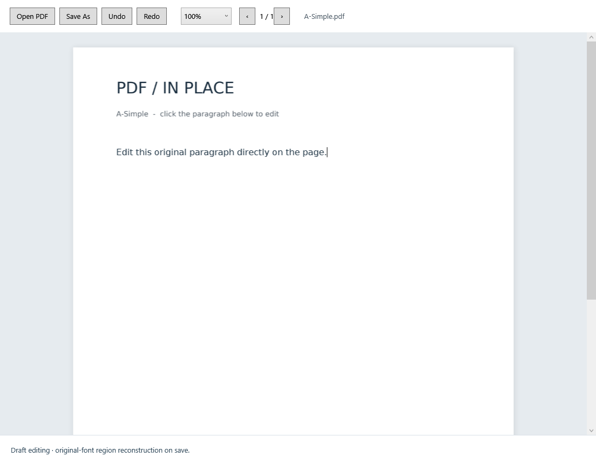
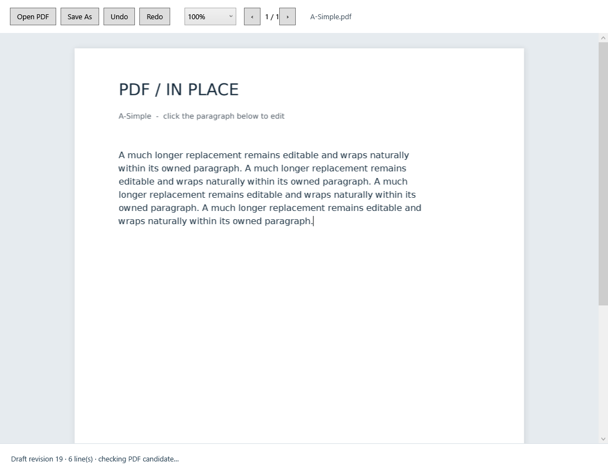
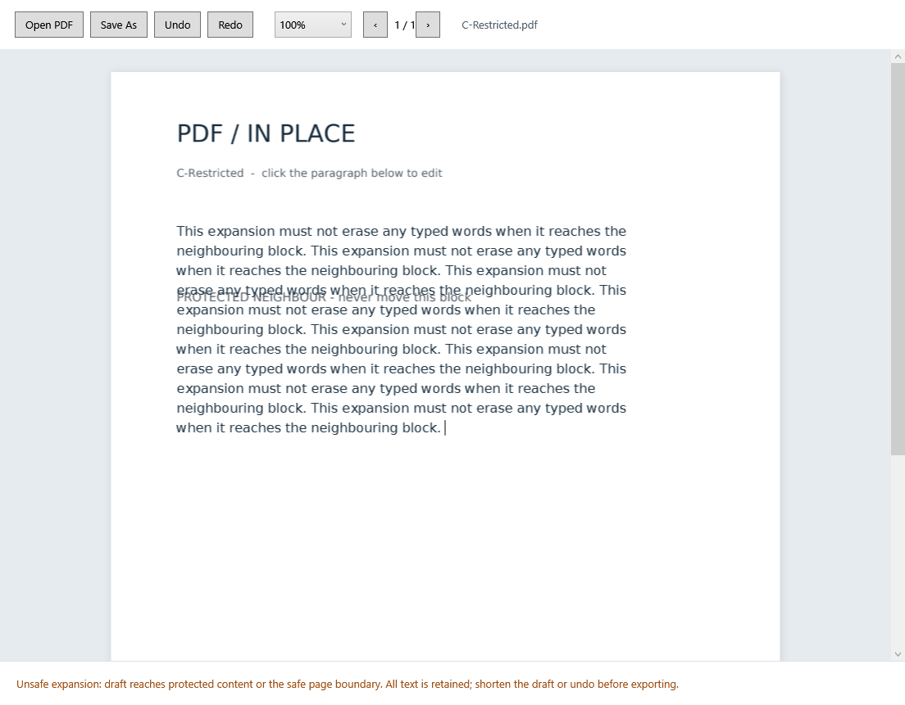
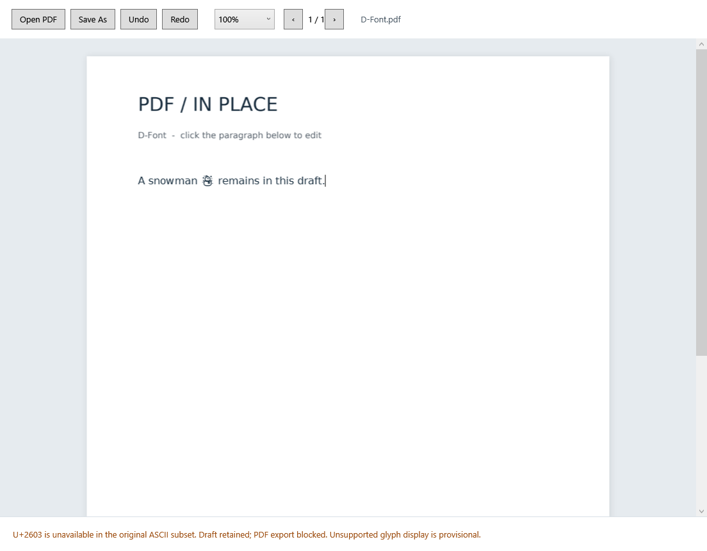

# Phase 2 test results

Date: 27 October 2026. Final build: WPF/.NET 8 target, Windows x64, PDFium 156.0.8076.0. Scope distinctions are important: backend tests, actual control integration and physical user-input testing are different evidence.

## Summary

| Suite | Executed result | What it establishes |
|---|---|---|
| Worker/backend | **18 passed / 18** | Ownership/glyph extraction, supported modification, wrapping, refusal, font/resource/geometry validation and source/destination protection on controlled files |
| Shown WPF window/control integration | **10 passed / 11; 1 failed** | Actual control geometry, current-document bitmap switching, routed text input/commands, history, wrapping, retained drafts, revision handling, save path and worker restart. The clipboard access test fails; it is not skipped or counted as passed. |
| Independent PDF checks | **2 representative PDFs x 2 resolutions passed** | Poppler outside-region raster comparisons, pypdf font programs and neighbouring run origins/style |
| External native UI automation | **Not completed** | Helper reported `failed to activate captured window`; refreshing the binding and retrying did not resolve it. Returned captures did not show the application correctly. |
| Physical mouse/keyboard, clipboard and file dialogs | **Manual verification pending** | A related unit/control test is not a substitute. See the user guide. |

Machine-readable results: [engine tests](evidence/engine-tests.json), [control tests](evidence/control-tests.json), [independent verification](evidence/independent-verification.json). Earlier failed control runs and the independent-tool error remain in `phase2/evidence/development/` in the project. No failing assertion was disabled to manufacture an all-green report.

## Required tests A-G

| Test | Expected | Actual evidence | Classification |
|---|---|---|---|
| A - simple paragraph | Click/edit a supported paragraph, wrap and genuinely save | Original glyph mapping and native editor activation checked; simple replacement passes worker reopen checks. Actual WPF draft also saved successfully. Physical click/file-picker traversal pending | Implemented; backend/control checks pass; manual input pending |
| B - longer replacement | Continue input beyond original rectangle and wrap | 363-character WPF draft retains all text; six native visual lines match six worker lines. Longer backend draft also wraps and passes pypdf/Poppler verification | Control/backend pass; physical typing pending |
| C - restricted space | Warn and preserve unsafe draft | 688-character control draft remains intact, unsafe status shown, undo/redo restores it. Backend rejects both safe-boundary overflow and a deliberately relaxed-boundary case that hits the actual neighbouring object | Pass at control/backend level |
| D - font limit | Diagnose unsupported original-font glyph without losing draft | U+2603 snowman retained in the control and recovery snapshot; worker blocks export with the code point. Source hash unchanged | Pass at control/backend level |
| E - zoom/caret | Correct placement at 75/100/150/200% | Indices 0/5/20/50 map correctly at all four zooms; actual control caret offsets inspected. Maximum horizontal caret-origin discrepancy approximately 0.179 pt | Sampled control geometry passes; physical mouse selection pending |
| F - undo/redo | Multiple insert/delete/replace actions undo/redo predictably | Native selection insertion, Backspace and replacement followed by three undos and three redos match expected text states. Overflow undo/redo also retains the full draft | Control history passes; keyboard shortcut traversal pending |
| G - save verification | Saved new PDF contains replacement and removes target | Native worker removes original text objects, saves/reopens/verifies. Actual working draft export succeeds; attempt to export over its source fails while retaining draft. Independent extraction of G confirms new text and absence of old paragraph | Save method/backend pass; Save As dialog traversal pending |

The screenshots below are **render captures of the actual WPF visual tree**, not mockups. Because desktop activation/capture failed, they are not presented as independent physical-desktop screenshots or proof of hardware input.

## Executed backend tests

The 18 tests recorded in `engine-tests.json` cover:

1. Actual page/clean render files and complete original glyph-index mapping.
2. Simple paragraph replacement; independent pypdf extraction; old target removal; font program and zero outside-pixel/geometry changes.
3. Longer replacement wraps and all characters survive the planned lines.
4. Restricted boundary rejects unsafe expansion without a destination file.
5. Actual neighbouring-object collision is rejected even when the copied fixture's safe boundary is deliberately relaxed.
6. Missing U+2603 glyph blocks export.
7. Original destination cannot be overwritten; source bytes identical.
8. Existing destination remains byte-identical.
9. An existing locked destination remains unchanged. This is preflight rejection, **not a mid-write disk-failure test**.
10. Stale source hash is rejected.
11. Appending intentionally retained original text leaves it only once, with original objects removed.
12. Deleting the entire paragraph produces genuine removal and zero new text objects.
13. Explicit line breaks and an empty line are preserved in layout.
14. Long unbroken ASCII text soft-wraps without losing characters.
15. An unchanged draft is not reported as a modified save.
16. A PDF without an ownership manifest renders in view-only mode.
17. A manifest whose original text does not match is rejected for editing.
18. Worker response revision equals the request revision.

These tests do not establish general paragraph discovery, arbitrary encodings, signed/encrypted/form content, or full PDF conformance. They also do not prove native input behaviour.

## Executed WPF control integration

The test runner uses a real shown `EditorWindow`, its `RichTextBox`, native editing commands, routed `TextInput`, actual selections/caret rectangles and the real child worker. It is not a detached layout model. Nonetheless, input is programmatic; physical key/mouse routing remains a separate acceptance step.

| Control check | Result | Evidence |
|---|---|---|
| PDF-glyph hit testing and caret at four zooms | Pass | 16 mappings; correct text offsets; maximum sampled horizontal error ~0.179 pt |
| Document-switch bitmap identity | Pass | Switch C/D/A; actual displayed bitmap pixels equal the current source render. Render cache keys include source hash. |
| Navigation, selection, deletion and routed input | Pass | Right/Left, Delete, Backspace, Home/End commands; selection replaced through WPF routed TextInput |
| Multi-action native undo/redo | Pass | Explicit control insertion, deletion/replacement and three undo/redo transitions. Insertion uses native Selection APIs to isolate history; physical typing is not inferred from it. |
| System copy/cut/paste and related history | **Fail** | Clipboard access step returns `System clipboard unavailable (Win32 5)`. Subsequent system copy/cut/paste assertions are not executed. History is verified separately above. |
| Live wrapping and candidate | Pass | Draft length 363; six visual lines and identical worker break positions; current revision verified |
| Restricted space retains history/draft | Pass | 688 characters retained; unsafe flag; undo/redo preserves draft |
| Unsupported font glyph retained | Pass | Snowman in working text/recovery; explicit diagnostic; original source unchanged |
| Working-state save and failed-save retention | Pass | Real PDF written through the application export method; attempt to overwrite source fails; draft unchanged |
| Revision protection | Pass | Earlier validation response does not overwrite newer draft; latest revision eventually verifies |
| Worker restart | Pass | Owned worker forcibly terminated between requests; next validation restarts it and preserves/verifies current draft |

The restart check is not an exhaustive in-flight crash, UI crash or power-loss test. The save integration bypasses only file-dialog selection of a destination, not content generation or verification.

## Independent visual/font results

Each comparison renders the original and output with Poppler at the same resolution. Threshold is maximum RGB-channel difference >8; a declared owned edit area is excluded. Counts are not comparisons between different rendering engines.

| Candidate | DPI | Total changed pixels | Outside owned region |
|---|---:|---:|---:|
| A simple edit | 72 | 1,728 | **0** |
| A simple edit | 144 | 5,639 | **0** |
| B longer edit | 72 | 12,668 | **0** |
| B longer edit | 144 | 39,211 | **0** |

pypdf independently confirms the same embedded font program SHA256 before/after, `ced1b2cb9d52bc4373ee3178af5bdd2cd8853bc49c5d06420dc3114f336ef398`, and unchanged origins/style for four neighbouring text runs per sample. This is run-origin checking, not an independent all-glyph bounding-box certification. Full renders are retained in `phase2/evidence/independent/`.

## Failures, corrections and tests not executed

- **Initial caret displacement:** 3.75 pt from an internal WPF selection margin. Corrected by aligning the editor's measured content origin; later four-zoom checks pass. Initial failing results retained.
- **Document-switch image caching:** visual review found a C filename with an A page image because a reused PNG URI hit WPF's image cache. Corrected with source-fingerprint render filenames and explicit image-cache bypass. The added displayed-bitmap comparison passes for C/D/A; final captures were regenerated.
- **Live baseline/spacing:** actual render inspection found a first-line offset; content-origin alignment and document-level line spacing were corrected. The tested long draft now matches worker wrap positions. Small cross-renderer glyph-edge differences are not claimed away.
- **Clipboard:** WPF OLE reported “Class not registered”. A Unicode Win32 adapter was implemented; Windows still returns Access denied. The final test remains failed. No clipboard simulation/fallback is counted as OS clipboard success.
- **Synthetic history-driver issue:** an added history sequence using repeated routed input produced an unexpected text state, and its following wrap check failed. The retained `control-sixth.json` records this. The history test was changed to explicit native control insertion after layout pumping, isolating undo history; the separate routed TextInput test remains. Both now pass. This does not certify repeated physical typing.
- **Missing independent tool:** `pdftotext` was unavailable, while `pdftoppm` was present. The attempted command/error is retained. Independent geometry inspection uses pypdf run origins/style instead of falsely claiming Poppler word boxes.
- **Desktop automation:** `failed to activate captured window`, including refreshed binding/retry. A common cause with clipboard denial is plausible but **not established**. No system settings or permissions were changed to bypass it.

Not executed: physical click/drag/keyboard/clipboard/file-dialog walkthrough, clean disconnected VM, self-contained publication, large/adversarial documents, input-to-paint latency measurement, mid-write/disk-full/power-loss injection, full accessibility, all DPI/display configurations, arbitrary fonts/encodings or general document reflow. These remain explicit review limitations.

## Acceptance conclusion

The narrow application and verified export path exist, with strong controlled backend evidence and sampled real-control integration. **Do not report Phase 2 as fully usability-certified:** clipboard execution is a retained failure and external physical-input verification remains pending. The manual checklist should be completed on an accessible interactive Windows desktop before the next architectural review.
