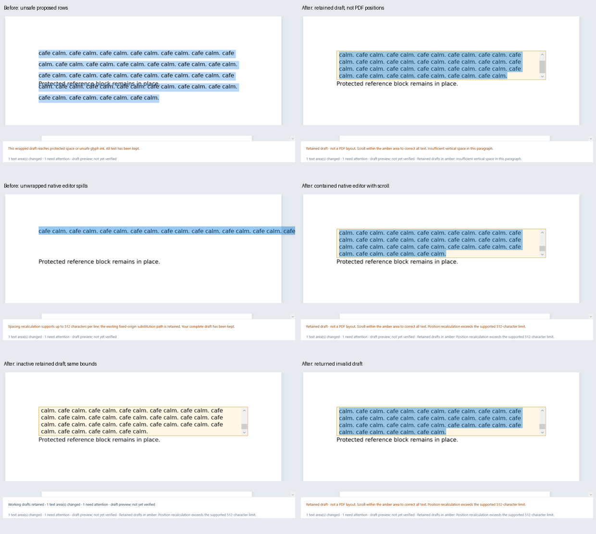
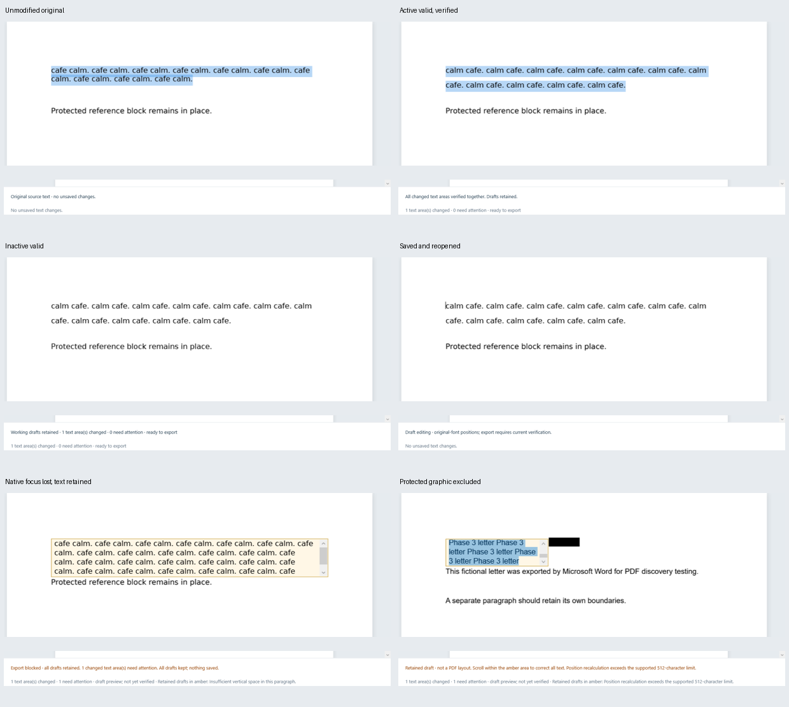

# Phase 5.2.1 visual comparison

Actual WPF captures were rendered and inspected. The user's original image files were not available; these comparisons use the genuine original Word cafe fixture and controlled replacement/append cases. Full clarification-brief payload tests retain only lengths/hashes in distributed evidence. Full, unaltered PNGs and paired state JSON remain in the timestamped evidence folders. Contact sheets only crop/scale those captures for review.

The old 329-character proposal draws rejected rows over the reference. The corrected view contains the exact draft inside an amber scrollable area above it. At 769 characters, the old native fallback extends beyond the page; the corrected active, inactive and returned views share contained dimensions. Scroll position/selection can change the visible excerpt; the complete stored string is unchanged and remains accessible through the native scrollbar/caret.

| Required state | Shipping capture filename |
|---|---|
| Original unmodified paragraph | original-unmodified.png |
| Active valid, pending | active-valid-pending.png |
| Active valid, verified | active-valid-verified.png |
| Inactive valid | inactive-valid.png |
| Active invalid long draft | replace-30-active.png; replace-70-active.png |
| Inactive invalid long draft | replace-30-inactive.png; replace-70-inactive.png |
| Returning to invalid draft | replace-30-returned.png; replace-70-returned.png |
| Native focus loss / selection return | invalid-blurred.png; invalid-returned-selection.png |
| Successfully saved/reopened | saved-reopened.png |
| Invalid draft near a graphic | invalid-near-graphic.png |

evidence/presentation-release.json identifies the exact shipping folder. visual-qa/captures.json identifies both baseline and shipping captures. Matrix screenshots cover every app zoom/window combination. Pending text is not called verified; current successful candidate validation enables Save As. Rejected views explicitly say retained draft/not PDF layout. Source and protected content do not move to make the draft fit.

The final protected-reference pixel test compares the actual rendered desktop region before/after rejected editing and focus loss, with zero changed bytes. Successful PDF outputs also pass independent 72/144-DPI checks outside the authorised edit area. This separates actual WPF presentation from exported-PDF correctness.

Earlier development captures include an Open-error candidate and screenshots taken before TextBlock rendering caught up with already-current verification data. They remain indexed as development evidence. Shipping captures wait for layout/render completion and their paired state JSON agrees. These programmatic WPF captures do not certify physical mouse/keyboard/clipboard use, OS display scales or accessibility.
