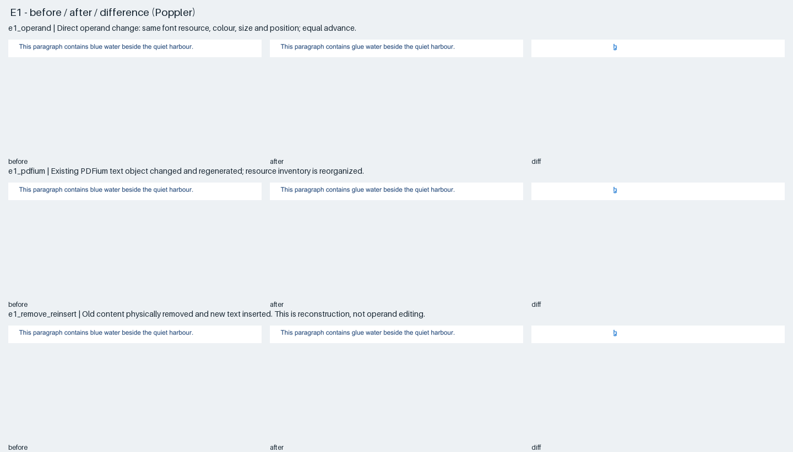
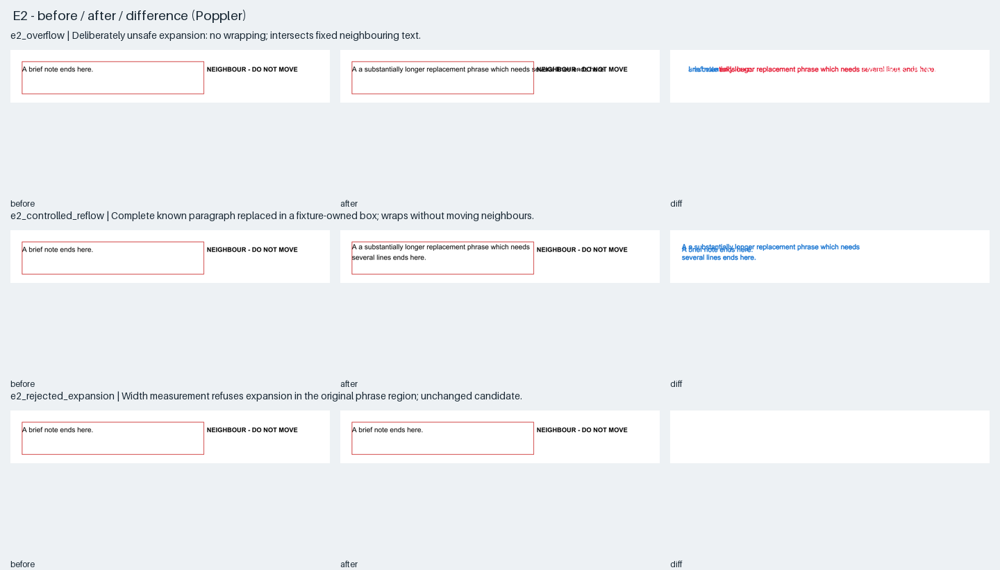
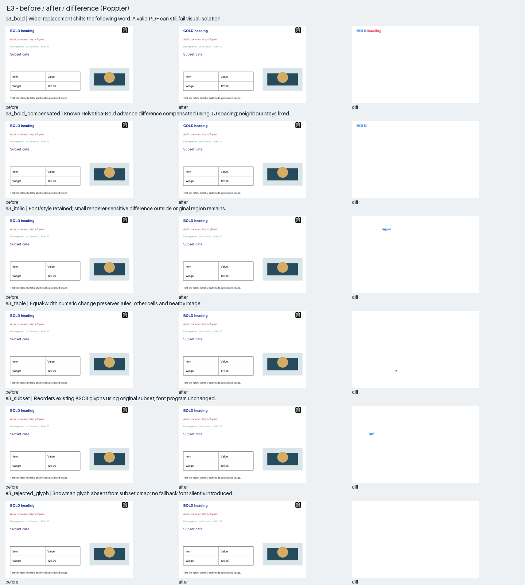
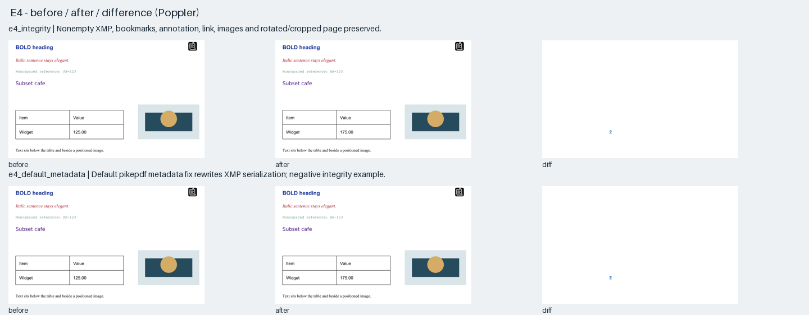
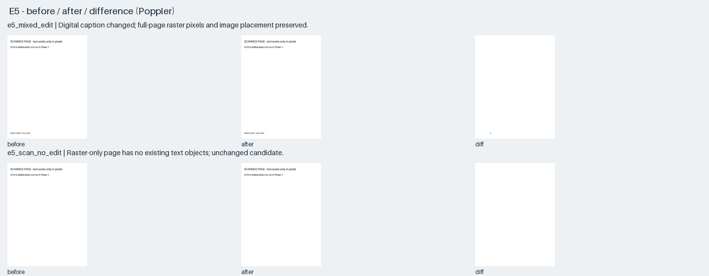

# Saved experiment evidence

Generated from `summary.json`. Before/after/diff PNGs are 144 DPI. Blue is change inside the allowed region; red is change outside it. Each renderer is compared against its own original rendering.

| Experiment | Outside pixels (MuPDF / PDFium / Poppler) | Finding |
|---|---:|---|
| [e1_operand](e1_operand.json) | 0 / 0 / 0 | Direct operand change: same font resource, colour, size and position; equal advance. |
| [e1_pdfium](e1_pdfium.json) | 0 / 0 / 0 | Existing PDFium text object changed and regenerated; resource inventory is reorganized. |
| [e1_remove_reinsert](e1_remove_reinsert.json) | 0 / 0 / 0 | Old content physically removed and new text inserted. This is reconstruction, not operand editing. |
| [e2_overflow](e2_overflow.json) | 5356 / 5829 / 5350 | Deliberately unsafe expansion: no wrapping; intersects fixed neighbouring text. |
| [e2_controlled_reflow](e2_controlled_reflow.json) | 0 / 0 / 0 | Complete known paragraph replaced in a fixture-owned box; wraps without moving neighbours. |
| [e3_bold](e3_bold.json) | 1204 / 1474 / 1222 | Wider replacement shifts the following word. A valid PDF can still fail visual isolation. |
| [e3_bold_compensated](e3_bold_compensated.json) | 0 / 0 / 0 | Known Helvetica-Bold advance difference compensated using TJ spacing; neighbour stays fixed. |
| [e3_italic](e3_italic.json) | 0 / 1 / 0 | Font/style retained; small renderer-sensitive difference outside original region remains. |
| [e3_table](e3_table.json) | 0 / 0 / 0 | Equal-width numeric change preserves rules, other cells and nearby image. |
| [e3_subset](e3_subset.json) | 0 / 0 / 0 | Reorders existing ASCII glyphs using original subset; font program unchanged. |
| [e4_integrity](e4_integrity.json) | 0 / 0 / 0 | Nonempty XMP, bookmarks, annotation, link, images and rotated/cropped page preserved. |
| [e4_default_metadata](e4_default_metadata.json) | 0 / 0 / 0 | Default pikepdf metadata fix rewrites XMP serialization; negative integrity example. |
| [e5_mixed_edit](e5_mixed_edit.json) | 0 / 0 / 0 | Digital caption changed; full-page raster pixels and image placement preserved. |
| [e2_rejected_expansion](e2_rejected_expansion.json) | 0 / 0 / 0 | Width measurement refuses expansion in the original phrase region; unchanged candidate. |
| [e3_rejected_glyph](e3_rejected_glyph.json) | 0 / 0 / 0 | Snowman glyph absent from subset cmap; no fallback font silently introduced. |
| [e5_scan_no_edit](e5_scan_no_edit.json) | 0 / 0 / 0 | Raster-only page has no existing text objects; unchanged candidate. |

